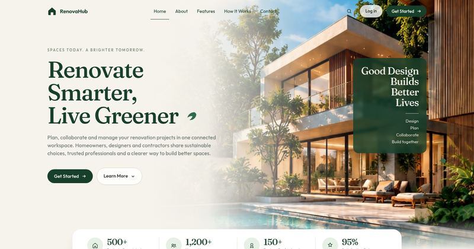
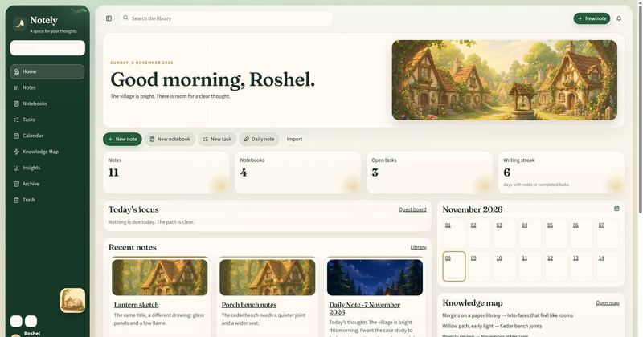
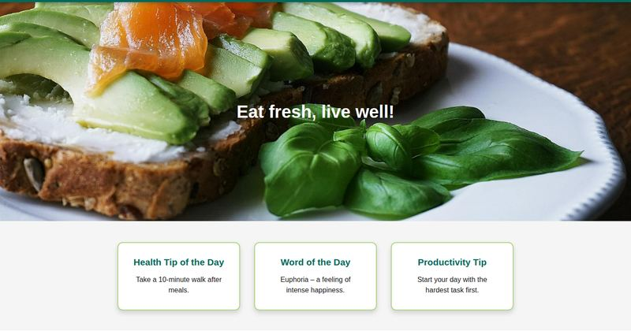
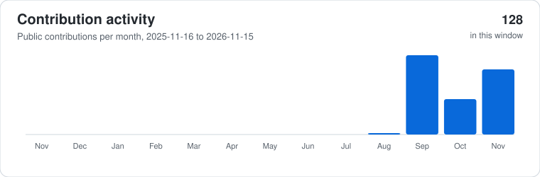

# Hi, I'm Roshel Peter

**Computer Science Undergraduate**

Software Engineering | Full-Stack Development

---

## About Me

I'm a Computer Science undergraduate at APIIT Sri Lanka interested in software engineering and full-stack development. I enjoy designing and developing practical software applications and working with frontend interfaces, backend systems and databases.

---

## Connect With Me

---

## Tech Stack

Technologies used in the projects below.

### Languages

JavaScript · TypeScript · PHP · C++ · HTML · CSS

### Frontend

React · Tailwind CSS

### Backend

Node.js · Express.js · Laravel · Livewire

### Databases

PostgreSQL · MySQL · SQLite

### Tools

Git · Docker

---

## Featured Projects

<table>
<tr>
<td width="50%">

<h3><a href="https://github.com/roshelpeter-cpu/RenovaHub">RenovaHub</a></h3>
Collaborative renovation project management platform for homeowners, designers and contractors.
  
Laravel · PHP · Livewire · MySQL
</td>
<td width="50%">

<h3><a href="https://github.com/roshelpeter-cpu/PerformX-360">PerformX 360</a></h3>
Role-based employee performance management system with PDP, evaluations, reviews and recognition.
  
React · TypeScript · Express · PostgreSQL
</td>
</tr>
</table>

<table>
<tr>
<td width="50%">

<h3><a href="https://github.com/roshelpeter-cpu/Eventra">Eventra</a></h3>
Full-stack event registration and ticket management platform.
  
React · JavaScript · Node.js · Express · SQLite
</td>
<td width="50%">

<h3><a href="https://github.com/roshelpeter-cpu/Notely">Notely</a></h3>
Personal knowledge management workspace for notes, tasks and ideas.
  
React · TypeScript · Express · SQLite
</td>
</tr>
<tr>
<td width="50%">
<h3><a href="https://github.com/roshelpeter-cpu/FloraGuard">FloraGuard</a></h3>
ESP32 nursery microclimate controller with environmental monitoring and automation.
  
C++ · ESP32 · IoT
  
Circuit screenshots are not in the repository yet.
</td>
<td width="50%">

<h3><a href="https://github.com/roshelpeter-cpu/GreenBite">GreenBite</a></h3>
Interactive health and wellness website with recipes, nutrition and workout tools.
  
HTML · CSS · JavaScript
</td>
</tr>
</table>

---

## GitHub Statistics

<picture>
  <source media="(prefers-color-scheme: dark)" srcset="https://github-profile-summary-cards.vercel.app/api/cards/stats?username=roshelpeter-cpu&theme=github_dark">
  <source media="(prefers-color-scheme: light)" srcset="https://github-profile-summary-cards.vercel.app/api/cards/stats?username=roshelpeter-cpu&theme=github">
  
</picture>
&nbsp;
<picture>
  <source media="(prefers-color-scheme: dark)" srcset="https://github-profile-summary-cards.vercel.app/api/cards/repos-per-language?username=roshelpeter-cpu&theme=github_dark">
  <source media="(prefers-color-scheme: light)" srcset="https://github-profile-summary-cards.vercel.app/api/cards/repos-per-language?username=roshelpeter-cpu&theme=github">
  
</picture>

<picture>
  <source media="(prefers-color-scheme: dark)" srcset="https://streak-stats.demolab.com/?user=roshelpeter-cpu&hide_border=true&theme=dark">
  <source media="(prefers-color-scheme: light)" srcset="https://streak-stats.demolab.com/?user=roshelpeter-cpu&hide_border=true&theme=default">
  
</picture>

### Contribution activity

<picture>
  <source media="(prefers-color-scheme: dark)" srcset="assets/analytics/activity-dark.svg">
  <source media="(prefers-color-scheme: light)" srcset="assets/analytics/activity-light.svg">
  
</picture>

Monthly public contribution totals. The contribution calendar already appears below this profile, so it is not repeated here.

The language card counts repositories by their primary language. It is not a measure of proficiency.
